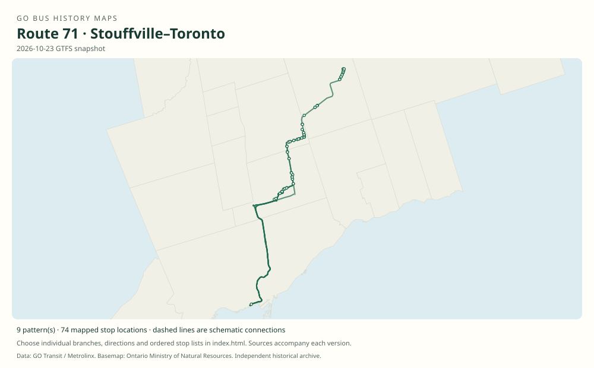

# GO route 71 — Stouffville–Toronto

The Stouffville corridor’s Union-bound bus family, historically extending to Uxbridge. Short workings, station bypasses and express variants changed with rail service, with route 70 providing many northern train connections.

**Status:** current. **Documented patterns:** 56. **Research date:** 23 October 2026.

[Download history PDF](route-71-history.pdf) · [Interactive map](index.html) · [All ordered stops (CSV)](stops.csv) · [All mapped versions (GeoJSON)](maps.geojson) · [History data](history.json) · [Timetable archive links](archive-sources.json)

The PDF includes the sourced history, dated maps, numbered stop lists and navigation bookmarks. Older versions retain the timetable timing-point or major-stop limits described below.

Open `index.html` through the repository's local web server to use the map. SVG maps below display directly on GitHub.

## History

### 2006-12-30

The recovered timetable documents Uxbridge–Goodwood–Stouffville–Markham–Union bus trips and shorter train-connecting trips.

[Source 1](https://go-schedule-archive.s3.us-east-1.amazonaws.com/stouffville/2008-03-03-table-71-stouffville.pdf)

### 2011-12-31

Lincolnville is included in the original Stouffville timetable, replacing the earlier north-Stouffville street timing point for relevant services.

[Source 1](https://go-schedule-archive.s3.us-east-1.amazonaws.com/stouffville/2012-02-14-table-71-stouffville.pdf)

### 2019-08-31

Routes 70 and 71 share the timetable; the 71 family includes multiple Union-bound and short variants.

[Source 1](https://go-schedule-archive.s3.us-east-1.amazonaws.com/stouffville/2019-08-31-table-71-stouffville.pdf)

### 2021-10-16

Lincolnville GO was renamed Old Elm GO.

[Source 1](https://www.townofws.ca/media/vfmhpfrw/stouffville_year-in-review_2021.pdf)

### 2023-10-17

Buses and trains began serving the relocated Old Elm station.

[Source 1](https://transittoronto.ca/archives/weblog/2023/10/16-go_relocat.shtml)

## Maps by documented version

Feed maps combine the patterns present in that dated file. The interactive viewer separates every branch and direction. A feed snapshot can include future or temporary service; its filename is not a route-change date.

| Date / evidence | Map | Patterns |
|---|---|---:|
| 2016-01-11 GTFS snapshot | [SVG map](maps/2016-01-11.svg) | 22 |
| 2022-03-08 GTFS snapshot | [SVG map](maps/2022-03-08.svg) | 12 |
| 2023-05-05 GTFS snapshot | [SVG map](maps/2023-05-05.svg) | 8 |
| 2026-10-23 GTFS snapshot | [SVG map](maps/2026-10-23.svg) | 9 |
| 2006-12-30 | [SVG map](maps/history-71-2006-main.svg) | 1 |
| 2006-12-30 | [SVG map](maps/history-71-2006-uxbridge-connector.svg) | 1 |
| 2019-08-31 | [SVG map](maps/history-71-2019-main.svg) | 1 |
| 2019-08-31 | [SVG map](maps/history-71-2019-c.svg) | 1 |
| 2023-01-07 | [SVG map](maps/history-71-2023-e.svg) | 1 |

## Historical major-stop sequences

These are timetable timing points / major stops, not necessarily every roadside stop. Full GTFS sequences are in `stops.csv` and the snapshot files.

### 2006-12-30 — 71: Uxbridge–Union through service

Uxbridge — Railway St / Spruce St → Goodwood — Highway 47 / Front St → Stouffville — Tenth Line / Bethesda Rd → Stouffville GO — Edward St / Main St → Dickson Hill — Highway 48 / 19th Ave → Mount Joy GO — Bur Oak Ave / Highway 48 → Markham GO — Main St / Ramona Blvd → Centennial GO — Bullock Dr / McCowan Rd → Markville Mall — McCowan Rd / Highway 7 → Unionville GO → Union Station Bus Terminal

Schematic straight connections between established stop areas, not a street-by-street reconstruction. Representative stopping bus pattern from Table 71. Some other rows bypass Centennial or Unionville; the shared train columns must not be treated as bus stops. No modern suffix is assigned to this older row. 1 stop locations remain unestablished; the full ordered sequence is preserved in the list.

[Original source 1](https://go-schedule-archive.s3.us-east-1.amazonaws.com/stouffville/2008-03-03-table-71-stouffville.pdf)

### 2006-12-30 — 71: Uxbridge–Stouffville train connection

Uxbridge — Railway St / Spruce St → Goodwood — Highway 47 / Front St → Stouffville — Tenth Line / Bethesda Rd → Stouffville GO — Edward St / Main St

Schematic straight connections between established stop areas, not a street-by-street reconstruction. A northern short-working in the original Table 71. Route 70 had not yet been established by this evidence. 1 stop locations remain unestablished; the full ordered sequence is preserved in the list.

[Original source 1](https://go-schedule-archive.s3.us-east-1.amazonaws.com/stouffville/2008-03-03-table-71-stouffville.pdf)

### 2019-08-31 — 71: Uxbridge–Union via Lincolnville

Uxbridge — Railway St / Albert St → Goodwood → Lincolnville GO — original Bethesda Rd site → Stouffville GO → Mount Joy GO → Markham GO → Centennial GO → Unionville GO → Union Station Bus Terminal

Schematic straight connections between established stop areas, not a street-by-street reconstruction. Major corridor timing points of the full through service. The original Lincolnville station site must be used.

[Original source 1](https://go-schedule-archive.s3.us-east-1.amazonaws.com/stouffville/2019-08-31-table-71-stouffville.pdf)

### 2019-08-31 — 71C: Lincolnville–Union

Lincolnville GO — original Bethesda Rd site → Stouffville GO → Mount Joy GO → Markham GO → Centennial GO → Unionville GO → Union Station Bus Terminal

Schematic straight connections between established stop areas, not a street-by-street reconstruction. Ordered major timetable timing points, not an exhaustive list of intermediate stops. Lines are schematic, not a surveyed road alignment.

[Original source 1](https://go-schedule-archive.s3.us-east-1.amazonaws.com/stouffville/2019-08-31-table-71-stouffville.pdf)

### 2023-01-07 — 71E: Mount Joy–Union short service

Mount Joy GO → Markham GO → Centennial GO → Unionville GO → Union Station Bus Terminal

Schematic straight connections between established stop areas, not a street-by-street reconstruction. Verified scheduled 71E bus row in January 2023. The older 2019 cover map displays 71E but the recovered service rows do not establish operation of that branch in that edition.

[Original source 1](https://go-schedule-archive.s3.us-east-1.amazonaws.com/stouffville/2023-01-07-table-71-stouffville.pdf)

## Coverage and unresolved questions

- The 2006 table contains several express and short-working combinations without sufficiently clear public suffixes; only the explicitly supported patterns are diagrammed.
- Earlier Uxbridge services to Scarborough Centre or downtown Toronto require separate historical timetables before assigning them a modern route number.
- These are documented dated snapshots. Changes between snapshots, temporary diversions and every historical local stop have not all been recovered.
- GTFS dates identify captured feeds, not necessarily the first or last day of a route. Open a pattern to see its exact scheduled service dates. Temporary rail replacement and special-service patterns are included when present in the source.
- Manually reconstructed versions generally contain published timetable timing points / major stops. They must not be read as complete roadside stop inventories.

## Sources

- [GO Stouffville Table 71, printed effective December 30, 2006; archive filename March 3, 2008](https://go-schedule-archive.s3.us-east-1.amazonaws.com/stouffville/2008-03-03-table-71-stouffville.pdf) — original-timetable
- [GO Stouffville schedule, printed effective December 31, 2011; archive filename February 14, 2012](https://go-schedule-archive.s3.us-east-1.amazonaws.com/stouffville/2012-02-14-table-71-stouffville.pdf) — original-timetable
- [GO Stouffville routes 70/71, effective August 31, 2019](https://go-schedule-archive.s3.us-east-1.amazonaws.com/stouffville/2019-08-31-table-71-stouffville.pdf) — original-timetable
- [Town of Whitchurch-Stouffville 2021 Year in Review: Lincolnville renamed October 16, 2021](https://www.townofws.ca/media/vfmhpfrw/stouffville_year-in-review_2021.pdf) — official
- [GO relocates Old Elm station, October 17, 2023 — Transit Toronto](https://transittoronto.ca/archives/weblog/2023/10/16-go_relocat.shtml) — secondary
- [GO Stouffville routes 70/71, effective January 7, 2023](https://go-schedule-archive.s3.us-east-1.amazonaws.com/stouffville/2023-01-07-table-71-stouffville.pdf) — original-timetable
- [GO Transit original GTFS snapshot 2016-01-11](https://openmobilitydata-data.s3.us-west-1.amazonaws.com/public/feeds/go-transit/32/20160111/gtfs.zip) — original-gtfs
- [GO Transit original GTFS snapshot 2022-03-08](https://web.archive.org/web/20220308054107id_/https://www.gotransit.com/static_files/gotransit/assets/Files/GO_GTFS.zip) — original-gtfs
- [GO Transit original GTFS snapshot 2023-05-05](https://openmobilitydata-data.s3.us-west-1.amazonaws.com/public/feeds/go-transit/32/20230505/gtfs.zip) — original-gtfs
- [GO Transit original GTFS snapshot 2026-10-23](https://assets.metrolinx.com/raw/upload/Documents/Metrolinx/Open%20Data/GO-GTFS.zip) — original-gtfs

## Data attribution

Data used in this product or service is provided with the permission of Metrolinx. Metrolinx makes no representations or warranties of any kind, express or implied, with respect to the Data and assumes no responsibility for the accuracy or currency of the data used in this product or service.

Basemap: Ontario Ministry of Natural Resources, Open Government Licence – Ontario. See [methodology](../../docs/METHODOLOGY.md) for geometry and date limitations.
