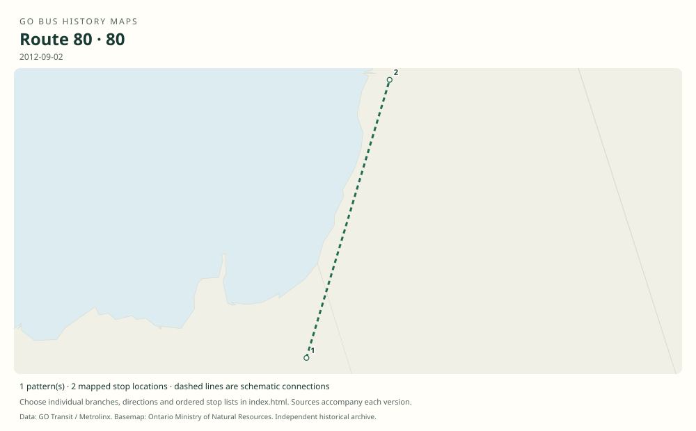

# GO route 80 — Pefferlaw–Beaverton

Short-lived rural connector replacing the northern end of the former Sutton route 69. It later passed to York Region Transit as route 51.

**Status:** discontinued. **Documented patterns:** 1. **Research date:** 23 October 2026.

[Download history PDF](route-80-history.pdf) · [Interactive map](index.html) · [All ordered stops (CSV)](stops.csv) · [All mapped versions (GeoJSON)](maps.geojson) · [History data](history.json) · [Timetable archive links](archive-sources.json)

The PDF includes the sourced history, dated maps, numbered stop lists and navigation bookmarks. Older versions retain the timetable timing-point or major-stop limits described below.

Open `index.html` through the repository's local web server to use the map. SVG maps below display directly on GitHub.

## History

### 2012-09-02

GO introduced route 80 between Pefferlaw and Beaverton.

[Source 1](https://www.newswire.ca/news-releases/new-adjusted-go-bus-service-for-richmond-hill-keswick-barrie-riders-school-service-returns-510584921.html)

### 2012-09-02

The launch schedule offered nine weekday trips in each direction and three on weekend days.

[Source 1](https://www.newswire.ca/news-releases/new-adjusted-go-bus-service-for-lakeshore-east-riders-school-service-returns-510584891.html)

### 2013-02-25

The YRT service-change notice still refers to connections with GO route 80.

[Source 1](https://transittoronto.ca/archives/weblog/2013/02/23-yrt_revise.shtml)

### by 2013-09

The original YRT system map shows route 51 Beaverton–Pefferlaw in the former GO corridor.

[Source 1](https://transittoronto.ca/archives/maps/YRT/YRT-system-map-201309.pdf)

## Maps by documented version

Feed maps combine the patterns present in that dated file. The interactive viewer separates every branch and direction. A feed snapshot can include future or temporary service; its filename is not a route-change date.

| Date / evidence | Map | Patterns |
|---|---|---:|
| 2012-09-02 | [SVG map](maps/history-80-2012-endpoints.svg) | 1 |

## Historical major-stop sequences

These are timetable timing points / major stops, not necessarily every roadside stop. Full GTFS sequences are in `stops.csv` and the snapshot files.

### 2012-09-02 — 80: Pefferlaw–Beaverton

Pefferlaw → Beaverton

Schematic straight connections between established stop areas, not a street-by-street reconstruction. Endpoint-only schematic. No original full route 80 stop list has been recovered; intermediate stops or exact roadway geometry must not be inferred from the former route 69.

[Original source 1](https://www.newswire.ca/news-releases/new-adjusted-go-bus-service-for-richmond-hill-keswick-barrie-riders-school-service-returns-510584921.html)

## Coverage and unresolved questions

- The transfer to YRT occurred in 2013, after the February connection notice and by the September system map; exact final GO service date remains unverified.
- Only endpoints are securely documented for mapping.
- These are documented dated snapshots. Changes between snapshots, temporary diversions and every historical local stop have not all been recovered.
- Manually reconstructed versions generally contain published timetable timing points / major stops. They must not be read as complete roadside stop inventories.

## Sources

- [GO Transit: New, adjusted bus service for Richmond Hill, Keswick and Barrie; August 15, 2012](https://www.newswire.ca/news-releases/new-adjusted-go-bus-service-for-richmond-hill-keswick-barrie-riders-school-service-returns-510584921.html) — official
- [GO Transit: New, adjusted bus service for Lakeshore East riders; August 15, 2012](https://www.newswire.ca/news-releases/new-adjusted-go-bus-service-for-lakeshore-east-riders-school-service-returns-510584891.html) — official
- [YRT revises services, February 25, 2013 — Transit Toronto](https://transittoronto.ca/archives/weblog/2013/02/23-yrt_revise.shtml) — secondary
- [Original York Region Transit system map, September 2013; route 51 Beaverton–Pefferlaw](https://transittoronto.ca/archives/maps/YRT/YRT-system-map-201309.pdf) — official

## Data attribution

Data used in this product or service is provided with the permission of Metrolinx. Metrolinx makes no representations or warranties of any kind, express or implied, with respect to the Data and assumes no responsibility for the accuracy or currency of the data used in this product or service.

Basemap: Ontario Ministry of Natural Resources, Open Government Licence – Ontario. See [methodology](../../docs/METHODOLOGY.md) for geometry and date limitations.
