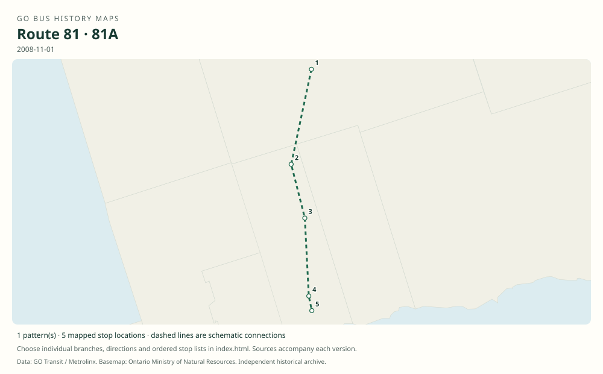

# GO route 81 — Port Perry–Whitby / Beaverton

Rural GO bus between Whitby GO, Port Perry and communities north to Beaverton. Timetables also show the short Port Perry–Whitby branch. Union times were connecting train times, not an 81 through bus.

**Status:** discontinued. **Documented patterns:** 13. **Research date:** 23 October 2026.

[Download history PDF](route-81-history.pdf) · [Interactive map](index.html) · [All ordered stops (CSV)](stops.csv) · [All mapped versions (GeoJSON)](maps.geojson) · [History data](history.json) · [Timetable archive links](archive-sources.json)

The PDF includes the sourced history, dated maps, numbered stop lists and navigation bookmarks. Older versions retain the timetable timing-point or major-stop limits described below.

Open `index.html` through the repository's local web server to use the map. SVG maps below display directly on GitHub.

## History

### 2008-11-01

The timetable documents Beaverton–Cannington–Sunderland–Port Perry–Whitby 81 and Port Perry–Whitby 81A.

[Source 1](https://go-schedule-archive.s3.us-east-1.amazonaws.com/port-perry/2008-12-03-table-81-port-perry.pdf)

### 2012-09

GO added Beaverton weekday trips and provided three weekend trips in each direction.

[Source 1](https://www.newswire.ca/news-releases/new-adjusted-go-bus-service-for-lakeshore-east-riders-school-service-returns-510584891.html)

### 2019-01-05

The route continued in the original Port Perry timetable.

[Source 1](https://go-schedule-archive.s3.us-east-1.amazonaws.com/port-perry/2019-01-05-table-81-port-perry.pdf)

### 2023-04-08

Route 81 was discontinued.

[Source 1](https://transittoronto.ca/archives/weblog/2023/04/08-go_revisin.shtml)

## Maps by documented version

Feed maps combine the patterns present in that dated file. The interactive viewer separates every branch and direction. A feed snapshot can include future or temporary service; its filename is not a route-change date.

| Date / evidence | Map | Patterns |
|---|---|---:|
| 2016-01-11 GTFS snapshot | [SVG map](maps/2016-01-11.svg) | 7 |
| 2022-03-08 GTFS snapshot | [SVG map](maps/2022-03-08.svg) | 4 |
| 2008-11-01 | [SVG map](maps/history-81-2008-main.svg) | 1 |
| 2008-11-01 | [SVG map](maps/history-81-2008-a.svg) | 1 |

## Historical major-stop sequences

These are timetable timing points / major stops, not necessarily every roadside stop. Full GTFS sequences are in `stops.csv` and the snapshot files.

### 2008-11-01 — 81: Beaverton–Port Perry–Whitby

Beaverton — Simcoe St / Mara Rd → Cannington — Cameron St / Ann St → Sunderland — Albert St / River St → Greenbank — Highway 12 / Cragg Rd → Port Perry — Reach St / Old Simcoe Rd → Port Perry — Curts St / Water St → Myrtle — Highway 12 / Myrtle Rd → Brooklin — Winchester Rd / Anderson St → Whitby — Brock St / Dundas St → Whitby GO

Schematic straight connections between established stop areas, not a street-by-street reconstruction. Major bus timing points; the Lakeshore train continuation shown in the table is excluded.

[Original source 1](https://go-schedule-archive.s3.us-east-1.amazonaws.com/port-perry/2008-12-03-table-81-port-perry.pdf)

### 2008-11-01 — 81A: Port Perry–Whitby short service

Port Perry — Curts St / Water St → Myrtle — Highway 12 / Myrtle Rd → Brooklin — Winchester Rd / Anderson St → Whitby — Brock St / Dundas St → Whitby GO

Schematic straight connections between established stop areas, not a street-by-street reconstruction. Ordered major timetable timing points, not an exhaustive list of intermediate stops. Lines are schematic, not a surveyed road alignment.

[Original source 1](https://go-schedule-archive.s3.us-east-1.amazonaws.com/port-perry/2008-12-03-table-81-port-perry.pdf)

## Coverage and unresolved questions

- The original launch date and every later local stop or road variation have not been recovered.
- These are documented dated snapshots. Changes between snapshots, temporary diversions and every historical local stop have not all been recovered.
- GTFS dates identify captured feeds, not necessarily the first or last day of a route. Open a pattern to see its exact scheduled service dates. Temporary rail replacement and special-service patterns are included when present in the source.
- Manually reconstructed versions generally contain published timetable timing points / major stops. They must not be read as complete roadside stop inventories.

## Sources

- [GO Port Perry Table 81, printed effective November 1, 2008; archive filename December 3](https://go-schedule-archive.s3.us-east-1.amazonaws.com/port-perry/2008-12-03-table-81-port-perry.pdf) — original-timetable
- [GO Transit: New, adjusted bus service for Lakeshore East riders; August 15, 2012](https://www.newswire.ca/news-releases/new-adjusted-go-bus-service-for-lakeshore-east-riders-school-service-returns-510584891.html) — official
- [GO Port Perry route 81, effective January 5, 2019](https://go-schedule-archive.s3.us-east-1.amazonaws.com/port-perry/2019-01-05-table-81-port-perry.pdf) — original-timetable
- [GO revises bus services, April 8, 2023 — Transit Toronto](https://transittoronto.ca/archives/weblog/2023/04/08-go_revisin.shtml) — secondary
- [GO Transit original GTFS snapshot 2016-01-11](https://openmobilitydata-data.s3.us-west-1.amazonaws.com/public/feeds/go-transit/32/20160111/gtfs.zip) — original-gtfs
- [GO Transit original GTFS snapshot 2022-03-08](https://web.archive.org/web/20220308054107id_/https://www.gotransit.com/static_files/gotransit/assets/Files/GO_GTFS.zip) — original-gtfs

## Data attribution

Data used in this product or service is provided with the permission of Metrolinx. Metrolinx makes no representations or warranties of any kind, express or implied, with respect to the Data and assumes no responsibility for the accuracy or currency of the data used in this product or service.

Basemap: Ontario Ministry of Natural Resources, Open Government Licence – Ontario. See [methodology](../../docs/METHODOLOGY.md) for geometry and date limitations.
