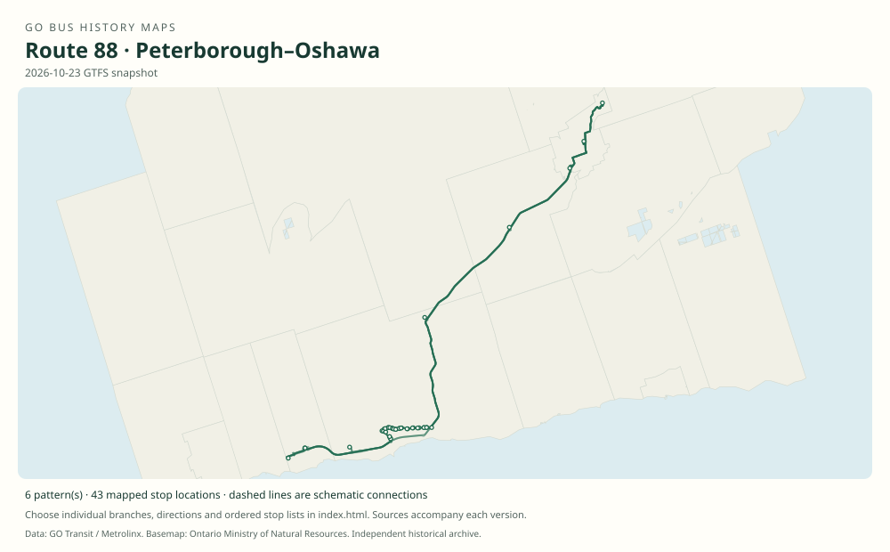

# GO route 88 — Peterborough–Oshawa

Express regional bus between Peterborough/Trent University and the Lakeshore East rail connection at Oshawa. Later branches added Bowmanville, Newcastle and additional park-and-ride stops.

**Status:** current. **Documented patterns:** 25. **Research date:** 23 October 2026.

[Download history PDF](route-88-history.pdf) · [Interactive map](index.html) · [All ordered stops (CSV)](stops.csv) · [All mapped versions (GeoJSON)](maps.geojson) · [History data](history.json) · [Timetable archive links](archive-sources.json)

The PDF includes the sourced history, dated maps, numbered stop lists and navigation bookmarks. Older versions retain the timetable timing-point or major-stop limits described below.

Open `index.html` through the repository's local web server to use the map. SVG maps below display directly on GitHub.

## History

### 2009-09

Daily Peterborough–Oshawa GO bus service began in September 2009.

[Source 1](https://assets.metrolinx.com/image/upload/v1663232128/Documents/Metrolinx/5123-GT-Metrolinx-AR-EN.pdf)

### by 2011-03-13

The original table shows Trent University–Peterborough–Highway 115 park-and-rides–Oshawa GO.

[Source 1](https://go-schedule-archive.s3.us-east-1.amazonaws.com/peterborough-oshawa/2011-03-13-table-88-peterborough-oshawa.pdf)

### 2020-09-05

Main 88 trips were routed through Bowmanville; weekday 88A replaced the former Newcastle route 91.

[Source 1](https://transittoronto.ca/archives/weblog/2020/09/04-go_revises.shtml)

### 2023-04-08

The timetable shows 88 and 88B through Bowmanville; 88B additionally serves Courtice/Baseline and First Avenue/Front park-and-rides.

[Source 1](https://go-schedule-archive.s3.us-east-1.amazonaws.com/peterborough-oshawa/2023-04-08-table-88-peterborough-oshawa.pdf)

## Maps by documented version

Feed maps combine the patterns present in that dated file. The interactive viewer separates every branch and direction. A feed snapshot can include future or temporary service; its filename is not a route-change date.

| Date / evidence | Map | Patterns |
|---|---|---:|
| 2016-01-11 GTFS snapshot | [SVG map](maps/2016-01-11.svg) | 4 |
| 2022-03-08 GTFS snapshot | [SVG map](maps/2022-03-08.svg) | 8 |
| 2023-05-05 GTFS snapshot | [SVG map](maps/2023-05-05.svg) | 4 |
| 2026-10-23 GTFS snapshot | [SVG map](maps/2026-10-23.svg) | 6 |
| by 2011-03-13 | [SVG map](maps/history-88-2011-main.svg) | 1 |
| 2023-04-08 | [SVG map](maps/history-88-2023-main.svg) | 1 |
| 2023-04-08 | [SVG map](maps/history-88-2023-b.svg) | 1 |

## Historical major-stop sequences

These are timetable timing points / major stops, not necessarily every roadside stop. Full GTFS sequences are in `stops.csv` and the snapshot files.

### by 2011-03-13 — 88: Peterborough–Oshawa express

Trent University — Peter Gzowski College → Peterborough Bus Terminal — Simcoe St / George St → Crawford Dr / Harper Rd Park & Ride → County Rd 10 / Highway 115 Park & Ride → Highway 35 / Highway 115 Park & Ride → Oshawa GO

Schematic straight connections between established stop areas, not a street-by-street reconstruction. Only the bus portion is shown. Union times in the timetable are connecting Lakeshore East train service.

[Original source 1](https://go-schedule-archive.s3.us-east-1.amazonaws.com/peterborough-oshawa/2011-03-13-table-88-peterborough-oshawa.pdf)

### 2023-04-08 — 88: Peterborough–Oshawa via Bowmanville

Trent University — Peter Gzowski College → Peterborough Bus Terminal — Simcoe St / George St → Crawford Dr / Harper Rd Park & Ride → County Rd 10 / Highway 115 Park & Ride → Highway 35 / Highway 115 Park & Ride → Highway 2 / Highway 35–115 → King St E / Liberty St — Bowmanville → Clarington Blvd / Highway 2 Park & Ride → Bowmanville Ave / Baseline Rd Park & Ride → Durham College Oshawa GO

Schematic straight connections between established stop areas, not a street-by-street reconstruction. Ordered major timetable timing points, not an exhaustive list of intermediate stops. Lines are schematic, not a surveyed road alignment.

[Original source 1](https://go-schedule-archive.s3.us-east-1.amazonaws.com/peterborough-oshawa/2023-04-08-table-88-peterborough-oshawa.pdf)

### 2023-04-08 — 88B: Peterborough–Oshawa with added park-and-rides

Trent University — Peter Gzowski College → Peterborough Bus Terminal — Simcoe St / George St → Crawford Dr / Harper Rd Park & Ride → County Rd 10 / Highway 115 Park & Ride → Highway 35 / Highway 115 Park & Ride → Highway 2 / Highway 35–115 → King St E / Liberty St — Bowmanville → Clarington Blvd / Highway 2 Park & Ride → Bowmanville Ave / Baseline Rd Park & Ride → Courtice Rd / Baseline Rd Park & Ride → First Ave / Front St Park & Ride — Oshawa → Durham College Oshawa GO

Schematic straight connections between established stop areas, not a street-by-street reconstruction. Ordered major timetable timing points, not an exhaustive list of intermediate stops. Lines are schematic, not a surveyed road alignment.

[Original source 1](https://go-schedule-archive.s3.us-east-1.amazonaws.com/peterborough-oshawa/2023-04-08-table-88-peterborough-oshawa.pdf)

## Coverage and unresolved questions

- Secondary accounts differ between September 4 and 5 for the 2009 opening; only the month is asserted here.
- The archived 2022 GTFS supplies the exact 88A Newcastle pattern; later 88C is captured in the current feed.
- These are documented dated snapshots. Changes between snapshots, temporary diversions and every historical local stop have not all been recovered.
- GTFS dates identify captured feeds, not necessarily the first or last day of a route. Open a pattern to see its exact scheduled service dates. Temporary rail replacement and special-service patterns are included when present in the source.
- Manually reconstructed versions generally contain published timetable timing points / major stops. They must not be read as complete roadside stop inventories.

## Sources

- [GO Transit / Metrolinx 2009–2010 Annual Report: Peterborough bus service launch](https://assets.metrolinx.com/image/upload/v1663232128/Documents/Metrolinx/5123-GT-Metrolinx-AR-EN.pdf) — official
- [GO Peterborough–Oshawa Table 88 archived March 13, 2011](https://go-schedule-archive.s3.us-east-1.amazonaws.com/peterborough-oshawa/2011-03-13-table-88-peterborough-oshawa.pdf) — original-timetable
- [GO revises routes and services, September 5, 2020 — Transit Toronto](https://transittoronto.ca/archives/weblog/2020/09/04-go_revises.shtml) — secondary
- [GO Peterborough–Oshawa route 88, effective April 8, 2023](https://go-schedule-archive.s3.us-east-1.amazonaws.com/peterborough-oshawa/2023-04-08-table-88-peterborough-oshawa.pdf) — original-timetable
- [GO Transit original GTFS snapshot 2016-01-11](https://openmobilitydata-data.s3.us-west-1.amazonaws.com/public/feeds/go-transit/32/20160111/gtfs.zip) — original-gtfs
- [GO Transit original GTFS snapshot 2022-03-08](https://web.archive.org/web/20220308054107id_/https://www.gotransit.com/static_files/gotransit/assets/Files/GO_GTFS.zip) — original-gtfs
- [GO Transit original GTFS snapshot 2023-05-05](https://openmobilitydata-data.s3.us-west-1.amazonaws.com/public/feeds/go-transit/32/20230505/gtfs.zip) — original-gtfs
- [GO Transit original GTFS snapshot 2026-10-23](https://assets.metrolinx.com/raw/upload/Documents/Metrolinx/Open%20Data/GO-GTFS.zip) — original-gtfs

## Data attribution

Data used in this product or service is provided with the permission of Metrolinx. Metrolinx makes no representations or warranties of any kind, express or implied, with respect to the Data and assumes no responsibility for the accuracy or currency of the data used in this product or service.

Basemap: Ontario Ministry of Natural Resources, Open Government Licence – Ontario. See [methodology](../../docs/METHODOLOGY.md) for geometry and date limitations.
