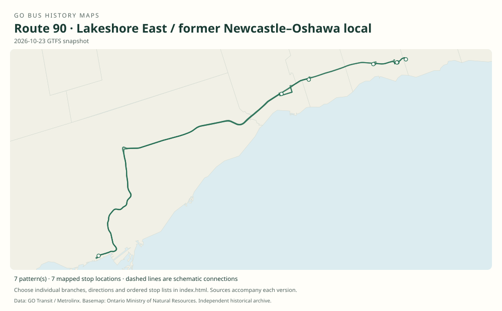

# GO route 90 — Lakeshore East / former Newcastle–Oshawa local

Historically included the local Newcastle–Bowmanville–Courtice–Oshawa GO feeder. That local service ended in 2020, while 90B Union–Oshawa rail-replacement service continued. The number therefore remains current.

**Status:** current. **Documented patterns:** 32. **Research date:** 23 October 2026.

[Download history PDF](route-90-history.pdf) · [Interactive map](index.html) · [All ordered stops (CSV)](stops.csv) · [All mapped versions (GeoJSON)](maps.geojson) · [History data](history.json) · [Timetable archive links](archive-sources.json)

The PDF includes the sourced history, dated maps, numbered stop lists and navigation bookmarks. Older versions retain the timetable timing-point or major-stop limits described below.

Open `index.html` through the repository's local web server to use the map. SVG maps below display directly on GitHub.

## History

### 2008-08-30

The Lakeshore East timetable includes the 90 Newcastle local, 90A Bowmanville short service, and 90B Union–Oshawa bus.

[Source 1](https://go-schedule-archive.s3.us-east-1.amazonaws.com/lakeshore-east/2008-12-03-table-09-lakeshore-east.pdf)

### by 2016-01

The original GTFS contains 90, 90A, 90B, 90C and 90D patterns.

[Source 1](https://openmobilitydata-data.s3.us-west-1.amazonaws.com/public/feeds/go-transit/32/20160111/gtfs.zip)

### 2020-12-05

Local route 90 was withdrawn after Durham Region Transit introduced overlapping 902A service; Metrolinx explicitly retained 90B.

[Source 1](https://www.metrolinx.com/en/discover/go-bus-route-90-to-be-discontinued)

### by 2023-05

The recovered original feed retains route 90B.

[Source 1](https://openmobilitydata-data.s3.us-west-1.amazonaws.com/public/feeds/go-transit/32/20230505/gtfs.zip)

## Maps by documented version

Feed maps combine the patterns present in that dated file. The interactive viewer separates every branch and direction. A feed snapshot can include future or temporary service; its filename is not a route-change date.

| Date / evidence | Map | Patterns |
|---|---|---:|
| 2016-01-11 GTFS snapshot | [SVG map](maps/2016-01-11.svg) | 14 |
| 2022-03-08 GTFS snapshot | [SVG map](maps/2022-03-08.svg) | 6 |
| 2023-05-05 GTFS snapshot | [SVG map](maps/2023-05-05.svg) | 2 |
| 2026-10-23 GTFS snapshot | [SVG map](maps/2026-10-23.svg) | 7 |
| 2008-08-30 | [SVG map](maps/history-90-2008-local.svg) | 1 |
| 2008-08-30 | [SVG map](maps/history-90-2008-a.svg) | 1 |
| 2008-08-30 | [SVG map](maps/history-90-2008-b.svg) | 1 |

## Historical major-stop sequences

These are timetable timing points / major stops, not necessarily every roadside stop. Full GTFS sequences are in `stops.csv` and the snapshot files.

### 2008-08-30 — 90: Newcastle–Oshawa local

Newcastle — Highway 2 / Mill St → Bowmanville — King St / Liberty St → Bowmanville GO Park & Ride — Prince William Blvd → Courtice — Highway 2 / Courtice Rd → Oshawa Bus Terminal — Bond St / Centre St → Oshawa GO — Thornton Rd / Bloor St

Schematic straight connections between established stop areas, not a street-by-street reconstruction. Ordered major timetable timing points, not an exhaustive list of intermediate stops. Lines are schematic, not a surveyed road alignment.

[Original source 1](https://go-schedule-archive.s3.us-east-1.amazonaws.com/lakeshore-east/2008-12-03-table-09-lakeshore-east.pdf)

### 2008-08-30 — 90A: Bowmanville–Oshawa short service

Bowmanville — Waverley Rd / Baseline Rd → Bowmanville — King St / Liberty St → Bowmanville GO Park & Ride — Prince William Blvd → Courtice — Highway 2 / Courtice Rd → Oshawa Bus Terminal — Bond St / Centre St → Oshawa GO — Thornton Rd / Bloor St

Schematic straight connections between established stop areas, not a street-by-street reconstruction. Ordered major timetable timing points, not an exhaustive list of intermediate stops. Lines are schematic, not a surveyed road alignment.

[Original source 1](https://go-schedule-archive.s3.us-east-1.amazonaws.com/lakeshore-east/2008-12-03-table-09-lakeshore-east.pdf)

### 2008-08-30 — 90B: Oshawa–Union rail replacement

Oshawa GO → Whitby GO → Ajax GO → Pickering GO → Union Station Bus Terminal

Schematic straight connections between established stop areas, not a street-by-street reconstruction. The early bus row stops at the four Durham rail stations and Union; it bypasses the intervening Toronto train stations.

[Original source 1](https://go-schedule-archive.s3.us-east-1.amazonaws.com/lakeshore-east/2008-12-03-table-09-lakeshore-east.pdf)

## Coverage and unresolved questions

- The word “discontinued” in the 2020 announcement applies to the Durham local service, not the whole number 90 family.
- Special construction shuttle suffixes are service-date-specific; see current GTFS validity rather than treating them as permanent routes.
- These are documented dated snapshots. Changes between snapshots, temporary diversions and every historical local stop have not all been recovered.
- GTFS dates identify captured feeds, not necessarily the first or last day of a route. Open a pattern to see its exact scheduled service dates. Temporary rail replacement and special-service patterns are included when present in the source.
- Manually reconstructed versions generally contain published timetable timing points / major stops. They must not be read as complete roadside stop inventories.

## Sources

- [GO Lakeshore East Table 09, printed effective August 30, 2008; includes bus routes 90/91](https://go-schedule-archive.s3.us-east-1.amazonaws.com/lakeshore-east/2008-12-03-table-09-lakeshore-east.pdf) — original-timetable
- [Original GO Transit GTFS archived January 11, 2016; use calendar validity, not retrieval date](https://openmobilitydata-data.s3.us-west-1.amazonaws.com/public/feeds/go-transit/32/20160111/gtfs.zip) — official
- [Metrolinx: GO bus Route 90 to be discontinued, November 18, 2020](https://www.metrolinx.com/en/discover/go-bus-route-90-to-be-discontinued) — official
- [Original GO Transit GTFS archived May 5, 2023; use calendar validity, not retrieval date](https://openmobilitydata-data.s3.us-west-1.amazonaws.com/public/feeds/go-transit/32/20230505/gtfs.zip) — official
- [GO Transit original GTFS snapshot 2022-03-08](https://web.archive.org/web/20220308054107id_/https://www.gotransit.com/static_files/gotransit/assets/Files/GO_GTFS.zip) — original-gtfs
- [GO Transit original GTFS snapshot 2026-10-23](https://assets.metrolinx.com/raw/upload/Documents/Metrolinx/Open%20Data/GO-GTFS.zip) — original-gtfs

## Data attribution

Data used in this product or service is provided with the permission of Metrolinx. Metrolinx makes no representations or warranties of any kind, express or implied, with respect to the Data and assumes no responsibility for the accuracy or currency of the data used in this product or service.

Basemap: Ontario Ministry of Natural Resources, Open Government Licence – Ontario. See [methodology](../../docs/METHODOLOGY.md) for geometry and date limitations.
