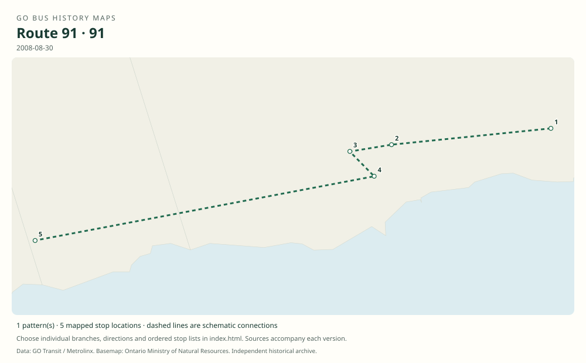

# GO route 91 — Newcastle–Oshawa express

Express feeder from Newcastle and Bowmanville to Oshawa GO, complementing the slower route 90 local bus. It was replaced by route 88A in the 2020 restructuring.

**Status:** discontinued. **Documented patterns:** 5. **Research date:** 23 October 2026.

[Download history PDF](route-91-history.pdf) · [Interactive map](index.html) · [All ordered stops (CSV)](stops.csv) · [All mapped versions (GeoJSON)](maps.geojson) · [History data](history.json) · [Timetable archive links](archive-sources.json)

The PDF includes the sourced history, dated maps, numbered stop lists and navigation bookmarks. Older versions retain the timetable timing-point or major-stop limits described below.

Open `index.html` through the repository's local web server to use the map. SVG maps below display directly on GitHub.

## History

### 2008-08-30

The original timetable distinguishes Newcastle–Bowmanville–Oshawa express 91 from local route 90.

[Source 1](https://go-schedule-archive.s3.us-east-1.amazonaws.com/lakeshore-east/2008-12-03-table-09-lakeshore-east.pdf)

### by 2016-01

The original GTFS still contains route 91 and its Newcastle pattern.

[Source 1](https://openmobilitydata-data.s3.us-west-1.amazonaws.com/public/feeds/go-transit/32/20160111/gtfs.zip)

### 2020-09-04

Last day of route 91. The replacement weekday 88A began with the September schedule changes.

[Source 1](https://transittoronto.ca/archives/weblog/2020/09/04-go_revises.shtml)

## Maps by documented version

Feed maps combine the patterns present in that dated file. The interactive viewer separates every branch and direction. A feed snapshot can include future or temporary service; its filename is not a route-change date.

| Date / evidence | Map | Patterns |
|---|---|---:|
| 2016-01-11 GTFS snapshot | [SVG map](maps/2016-01-11.svg) | 4 |
| 2008-08-30 | [SVG map](maps/history-91-2008-main.svg) | 1 |

## Historical major-stop sequences

These are timetable timing points / major stops, not necessarily every roadside stop. Full GTFS sequences are in `stops.csv` and the snapshot files.

### 2008-08-30 — 91: Newcastle–Bowmanville–Oshawa express

Newcastle — Highway 2 / Mill St → Bowmanville — King St / Liberty St → Bowmanville GO Park & Ride — Prince William Blvd → Bowmanville — Waverley Rd / Baseline Rd → Oshawa GO — Thornton Rd / Bloor St

Schematic straight connections between established stop areas, not a street-by-street reconstruction. The bus bypasses Courtice and downtown Oshawa; the Lakeshore East train continuation is not part of route 91.

[Original source 1](https://go-schedule-archive.s3.us-east-1.amazonaws.com/lakeshore-east/2008-12-03-table-09-lakeshore-east.pdf)

## Coverage and unresolved questions

- Later Newcastle local circulation differs from the simple 2008 timing-point diagram; the 2016 GTFS supplies its full stop sequence.
- These are documented dated snapshots. Changes between snapshots, temporary diversions and every historical local stop have not all been recovered.
- GTFS dates identify captured feeds, not necessarily the first or last day of a route. Open a pattern to see its exact scheduled service dates. Temporary rail replacement and special-service patterns are included when present in the source.
- Manually reconstructed versions generally contain published timetable timing points / major stops. They must not be read as complete roadside stop inventories.

## Sources

- [GO Lakeshore East Table 09, printed effective August 30, 2008; includes bus routes 90/91](https://go-schedule-archive.s3.us-east-1.amazonaws.com/lakeshore-east/2008-12-03-table-09-lakeshore-east.pdf) — original-timetable
- [Original GO Transit GTFS archived January 11, 2016; use calendar validity, not retrieval date](https://openmobilitydata-data.s3.us-west-1.amazonaws.com/public/feeds/go-transit/32/20160111/gtfs.zip) — official
- [GO revises routes and services, September 5, 2020 — Transit Toronto](https://transittoronto.ca/archives/weblog/2020/09/04-go_revises.shtml) — secondary

## Data attribution

Data used in this product or service is provided with the permission of Metrolinx. Metrolinx makes no representations or warranties of any kind, express or implied, with respect to the Data and assumes no responsibility for the accuracy or currency of the data used in this product or service.

Basemap: Ontario Ministry of Natural Resources, Open Government Licence – Ontario. See [methodology](../../docs/METHODOLOGY.md) for geometry and date limitations.
