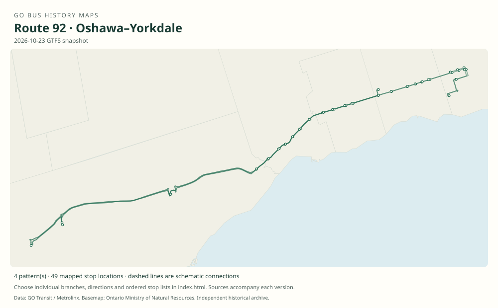

# GO route 92 — Oshawa–Yorkdale

Limited-stop Highway 2 service linking Durham communities with Scarborough Centre and North York. The eastern terminal and the meaning of the 92A suffix have both changed.

**Status:** current. **Documented patterns:** 27. **Research date:** 23 October 2026.

[Download history PDF](route-92-history.pdf) · [Interactive map](index.html) · [All ordered stops (CSV)](stops.csv) · [All mapped versions (GeoJSON)](maps.geojson) · [History data](history.json) · [Timetable archive links](archive-sources.json)

The PDF includes the sourced history, dated maps, numbered stop lists and navigation bookmarks. Older versions retain the timetable timing-point or major-stop limits described below.

Open `index.html` through the repository's local web server to use the map. SVG maps below display directly on GitHub.

## History

### 2013-06-29

Route 92 was introduced in the Highway 2 reorganization replacing the old 94/95 network.

[Source 1](https://transittoronto.ca/archives/weblog/2013/06/15-major_chan.shtml)

### 2014-09-02

New 92A Ajax–Finch service replaced route 98.

[Source 1](https://transittoronto.ca/archives/weblog/2014/08/28-go_revises.shtml)

### 2019-04-06

The original timetable shows downtown Oshawa–Yorkdale service; by this edition 92A has become a Dundas/Highway 412–Yorkdale short working.

[Source 1](https://go-schedule-archive.s3.us-east-1.amazonaws.com/oshawa-yorkdale/2019-04-06-table-92-oshawa-yorkdale.pdf)

### 2020-09-05

The main route moved its eastern terminal from downtown Oshawa to Oshawa GO.

[Source 1](https://transittoronto.ca/archives/weblog/2020/09/04-go_revises.shtml)

### by 2023-05

The original GTFS retains the later 92A Dundas/Highway 412–Yorkdale short working.

[Source 1](https://openmobilitydata-data.s3.us-west-1.amazonaws.com/public/feeds/go-transit/32/20230505/gtfs.zip)

## Maps by documented version

Feed maps combine the patterns present in that dated file. The interactive viewer separates every branch and direction. A feed snapshot can include future or temporary service; its filename is not a route-change date.

| Date / evidence | Map | Patterns |
|---|---|---:|
| 2016-01-11 GTFS snapshot | [SVG map](maps/2016-01-11.svg) | 8 |
| 2022-03-08 GTFS snapshot | [SVG map](maps/2022-03-08.svg) | 8 |
| 2023-05-05 GTFS snapshot | [SVG map](maps/2023-05-05.svg) | 4 |
| 2026-10-23 GTFS snapshot | [SVG map](maps/2026-10-23.svg) | 4 |
| 2014-09-02 | [SVG map](maps/history-92-2014-a.svg) | 1 |
| 2019-04-06 | [SVG map](maps/history-92-2019-main.svg) | 1 |
| 2019-04-06 | [SVG map](maps/history-92-2019-a.svg) | 1 |

## Historical major-stop sequences

These are timetable timing points / major stops, not necessarily every roadside stop. Full GTFS sequences are in `stops.csv` and the snapshot files.

### 2014-09-02 — 92A: Original 92A Ajax–Finch branch

Kingston Rd / Harwood Ave — Ajax → Kingston Rd / Westney Rd — Ajax → Kingston Rd / Church St — Ajax → Kingston Rd / Brock Rd — Pickering → Kingston Rd / Glenanna Rd — Pickering → Kingston Rd / Fairport Rd — Pickering → Kingston Rd / Sheppard Ave E → Scarborough Centre Bus Terminal → Yonge St / Sheppard Ave → Finch Bus Terminal

Schematic straight connections between established stop areas, not a street-by-street reconstruction. Selected principal stops from the contemporary route description. Full original 2016 GTFS additionally preserves the intermediate street stops.

[Original source 1](https://transittoronto.ca/archives/weblog/2014/08/28-go_revises.shtml)

### 2019-04-06 — 92: Downtown Oshawa–Yorkdale via Highway 2

Oshawa Bus Terminal → Dundas St / Thickson Rd — Whitby → Dundas St / Brock St — Whitby → Kingston Rd / Harwood Ave — Ajax → Kingston Rd / Glenanna Rd — Pickering → Kingston Rd / Fairport Rd — Pickering → Kingston Rd / Sheppard Ave E → Scarborough Centre Bus Terminal → York Mills Bus Terminal → Yorkdale Bus Terminal

Schematic straight connections between established stop areas, not a street-by-street reconstruction. Printed timing points of the main 92 bus row. The Dundas/Highway 412 column belongs to the short 92A branch and is bypassed by main 92.

[Original source 1](https://go-schedule-archive.s3.us-east-1.amazonaws.com/oshawa-yorkdale/2019-04-06-table-92-oshawa-yorkdale.pdf)

### 2019-04-06 — 92A: Later 92A Dundas/Highway 412–Yorkdale

Dundas St / Highway 412 → Kingston Rd / Harwood Ave — Ajax → Kingston Rd / Glenanna Rd — Pickering → Kingston Rd / Fairport Rd — Pickering → Kingston Rd / Sheppard Ave E → Scarborough Centre Bus Terminal → York Mills Bus Terminal → Yorkdale Bus Terminal

Schematic straight connections between established stop areas, not a street-by-street reconstruction. This 92A is already different from the 2014 Ajax–Finch branch. It ends at Yorkdale via York Mills.

[Original source 1](https://go-schedule-archive.s3.us-east-1.amazonaws.com/oshawa-yorkdale/2019-04-06-table-92-oshawa-yorkdale.pdf)

## Coverage and unresolved questions

- The 92A reassignment took place after the recovered 2016 Finch pattern and by the April 2019 timetable; its precise effective date has not been established.
- Selected timing-point patterns omit local stops; use the feed snapshots for full dated stop sequences.
- These are documented dated snapshots. Changes between snapshots, temporary diversions and every historical local stop have not all been recovered.
- GTFS dates identify captured feeds, not necessarily the first or last day of a route. Open a pattern to see its exact scheduled service dates. Temporary rail replacement and special-service patterns are included when present in the source.
- Manually reconstructed versions generally contain published timetable timing points / major stops. They must not be read as complete roadside stop inventories.

## Sources

- [Major changes to GO bus service along Highway 2, June 29, 2013 — Transit Toronto](https://transittoronto.ca/archives/weblog/2013/06/15-major_chan.shtml) — secondary
- [GO revises services September 2, 2014, including 98 replacement by 92A — Transit Toronto](https://transittoronto.ca/archives/weblog/2014/08/28-go_revises.shtml) — secondary
- [GO Oshawa–Yorkdale route 92, effective April 6, 2019](https://go-schedule-archive.s3.us-east-1.amazonaws.com/oshawa-yorkdale/2019-04-06-table-92-oshawa-yorkdale.pdf) — original-timetable
- [GO revises routes and services, September 5, 2020 — Transit Toronto](https://transittoronto.ca/archives/weblog/2020/09/04-go_revises.shtml) — secondary
- [Original GO Transit GTFS archived May 5, 2023; use calendar validity, not retrieval date](https://openmobilitydata-data.s3.us-west-1.amazonaws.com/public/feeds/go-transit/32/20230505/gtfs.zip) — official
- [GO Transit original GTFS snapshot 2016-01-11](https://openmobilitydata-data.s3.us-west-1.amazonaws.com/public/feeds/go-transit/32/20160111/gtfs.zip) — original-gtfs
- [GO Transit original GTFS snapshot 2022-03-08](https://web.archive.org/web/20220308054107id_/https://www.gotransit.com/static_files/gotransit/assets/Files/GO_GTFS.zip) — original-gtfs
- [GO Transit original GTFS snapshot 2026-10-23](https://assets.metrolinx.com/raw/upload/Documents/Metrolinx/Open%20Data/GO-GTFS.zip) — original-gtfs

## Data attribution

Data used in this product or service is provided with the permission of Metrolinx. Metrolinx makes no representations or warranties of any kind, express or implied, with respect to the Data and assumes no responsibility for the accuracy or currency of the data used in this product or service.

Basemap: Ontario Ministry of Natural Resources, Open Government Licence – Ontario. See [methodology](../../docs/METHODOLOGY.md) for geometry and date limitations.
