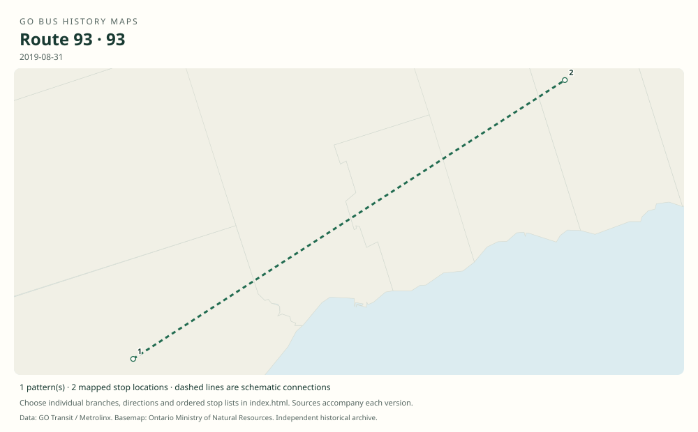

# GO route 93 — Durham College / UOIT–Scarborough Centre

School-oriented express bus between Scarborough Centre and the shared north Oshawa campus of Durham College and UOIT (now Ontario Tech). Some archive filenames incorrectly identify an original route 93 PDF as route 96.

**Status:** discontinued. **Documented patterns:** 6. **Research date:** 23 October 2026.

[Download history PDF](route-93-history.pdf) · [Interactive map](index.html) · [All ordered stops (CSV)](stops.csv) · [All mapped versions (GeoJSON)](maps.geojson) · [History data](history.json) · [Timetable archive links](archive-sources.json)

The PDF includes the sourced history, dated maps, numbered stop lists and navigation bookmarks. Older versions retain the timetable timing-point or major-stop limits described below.

Open `index.html` through the repository's local web server to use the map. SVG maps below display directly on GitHub.

## History

### 2009-01-03

The original timetable explicitly identifies the campus express as route 93.

[Source 1](https://go-schedule-archive.s3.us-east-1.amazonaws.com/oshawa-finch-express/2009-02-19-table-96-oshawa-finch-express.pdf)

### 2012-09

School service was restored with additional weekday eastbound trips.

[Source 1](https://www.newswire.ca/news-releases/new-adjusted-go-bus-service-for-lakeshore-east-riders-school-service-returns-510584891.html)

### 2019-08-31

The route remained in the original school-year timetable.

[Source 1](https://go-schedule-archive.s3.us-east-1.amazonaws.com/durham-college-uoit/2019-08-31-table-93-durham-college-uoit.pdf)

### 2020-09

The September service-change notice states that route 93 remained suspended.

[Source 1](https://transittoronto.ca/archives/weblog/2020/09/04-go_revises.shtml)

## Maps by documented version

Feed maps combine the patterns present in that dated file. The interactive viewer separates every branch and direction. A feed snapshot can include future or temporary service; its filename is not a route-change date.

| Date / evidence | Map | Patterns |
|---|---|---:|
| 2016-01-11 GTFS snapshot | [SVG map](maps/2016-01-11.svg) | 4 |
| 2009-01-03 | [SVG map](maps/history-93-2009-main.svg) | 1 |
| 2019-08-31 | [SVG map](maps/history-93-2019-main.svg) | 1 |

## Historical major-stop sequences

These are timetable timing points / major stops, not necessarily every roadside stop. Full GTFS sequences are in `stops.csv` and the snapshot files.

### 2009-01-03 — 93: Scarborough Centre–Durham College/UOIT

Scarborough Centre Bus Terminal → Durham College / UOIT — north Oshawa campus

Schematic straight connections between established stop areas, not a street-by-street reconstruction. Original document is route 93 despite archive filename mentioning 96. Only terminal timing points are published.

[Original source 1](https://go-schedule-archive.s3.us-east-1.amazonaws.com/oshawa-finch-express/2009-02-19-table-96-oshawa-finch-express.pdf)

### 2019-08-31 — 93: Scarborough Centre–north Oshawa campus

Scarborough Centre Bus Terminal → Durham College / UOIT — north Oshawa campus

Schematic straight connections between established stop areas, not a street-by-street reconstruction. Cover map follows Highway 401, Thickson Road, Taunton Road and Simcoe Street. The endpoint schematic does not imply a nonstop straight-road alignment.

[Original source 1](https://go-schedule-archive.s3.us-east-1.amazonaws.com/durham-college-uoit/2019-08-31-table-93-durham-college-uoit.pdf)

## Coverage and unresolved questions

- The exact initial suspension day and formal permanent withdrawal date have not been verified. September 2020 evidence establishes continued suspension, not a newly effective cancellation.
- These are documented dated snapshots. Changes between snapshots, temporary diversions and every historical local stop have not all been recovered.
- GTFS dates identify captured feeds, not necessarily the first or last day of a route. Open a pattern to see its exact scheduled service dates. Temporary rail replacement and special-service patterns are included when present in the source.
- Manually reconstructed versions generally contain published timetable timing points / major stops. They must not be read as complete roadside stop inventories.

## Sources

- [Original GO Durham College–UOIT route 93, printed January 3, 2009; misleading archive filename says 96](https://go-schedule-archive.s3.us-east-1.amazonaws.com/oshawa-finch-express/2009-02-19-table-96-oshawa-finch-express.pdf) — original-timetable
- [GO Transit: New, adjusted bus service for Lakeshore East riders; August 15, 2012](https://www.newswire.ca/news-releases/new-adjusted-go-bus-service-for-lakeshore-east-riders-school-service-returns-510584891.html) — official
- [GO Durham College/UOIT route 93, effective August 31, 2019](https://go-schedule-archive.s3.us-east-1.amazonaws.com/durham-college-uoit/2019-08-31-table-93-durham-college-uoit.pdf) — original-timetable
- [GO revises routes and services, September 5, 2020 — Transit Toronto](https://transittoronto.ca/archives/weblog/2020/09/04-go_revises.shtml) — secondary
- [GO Transit original GTFS snapshot 2016-01-11](https://openmobilitydata-data.s3.us-west-1.amazonaws.com/public/feeds/go-transit/32/20160111/gtfs.zip) — original-gtfs

## Data attribution

Data used in this product or service is provided with the permission of Metrolinx. Metrolinx makes no representations or warranties of any kind, express or implied, with respect to the Data and assumes no responsibility for the accuracy or currency of the data used in this product or service.

Basemap: Ontario Ministry of Natural Resources, Open Government Licence – Ontario. See [methodology](../../docs/METHODOLOGY.md) for geometry and date limitations.
