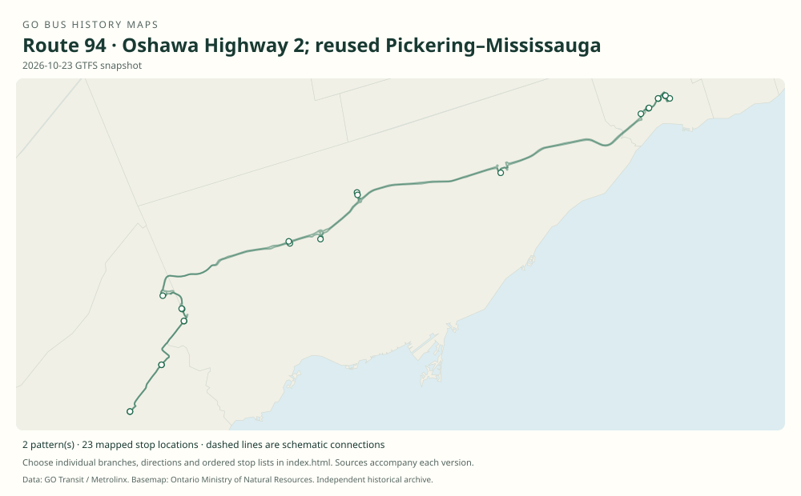

# GO route 94 — Oshawa Highway 2; reused Pickering–Mississauga

Number 94 was reused for a different corridor: the old Oshawa–Yorkdale Highway 2 bus ended in 2013; a new Pickering–Mississauga service began in 2020 and later incorporated Pearson Airport service.

**Status:** current. **Documented patterns:** 11. **Research date:** 23 October 2026.

[Download history PDF](route-94-history.pdf) · [Interactive map](index.html) · [All ordered stops (CSV)](stops.csv) · [All mapped versions (GeoJSON)](maps.geojson) · [History data](history.json) · [Timetable archive links](archive-sources.json)

The PDF includes the sourced history, dated maps, numbered stop lists and navigation bookmarks. Older versions retain the timetable timing-point or major-stop limits described below.

Open `index.html` through the repository's local web server to use the map. SVG maps below display directly on GitHub.

## History

### 2007-10-27

The original route 94 timetable is Oshawa Highway 2, serving Oshawa GO, downtown Oshawa, Whitby, Ajax, Pickering, Scarborough, York Mills and Yorkdale.

[Source 1](https://go-schedule-archive.s3.us-east-1.amazonaws.com/pickering-mississauga/2008-12-03-table-94-pickering-mississauga.pdf)

### 2013-06-28

Final day of the old Highway 2 route 94 before the Durham service restructuring.

[Source 1](https://transittoronto.ca/archives/weblog/2013/06/15-major_chan.shtml)

### 2020-09-08

First weekday service of the new route 94 Pickering–Square One, introduced in the September schedule changes.

[Source 1](https://transittoronto.ca/archives/weblog/2020/09/04-go_revises.shtml)

### 2023-01-07

The pre-airport timetable shows Pickering–Scarborough–Yorkdale–Keele/401–Square One.

[Source 1](https://go-schedule-archive.s3.us-east-1.amazonaws.com/pickering-mississauga/2023-01-07-table-94-pickering-mississauga.pdf)

### 2023-04-08

Routes 34 and 94 were combined; the revised 94 includes Pearson Terminal 1 and Transitway stops.

[Source 1](https://www.gotransit.com/en/blog/april-service-changes) · [Source 2](https://go-schedule-archive.s3.us-east-1.amazonaws.com/pickering-mississauga/2023-04-08-table-94-pickering-mississauga.pdf)

## Maps by documented version

Feed maps combine the patterns present in that dated file. The interactive viewer separates every branch and direction. A feed snapshot can include future or temporary service; its filename is not a route-change date.

| Date / evidence | Map | Patterns |
|---|---|---:|
| 2022-03-08 GTFS snapshot | [SVG map](maps/2022-03-08.svg) | 4 |
| 2023-05-05 GTFS snapshot | [SVG map](maps/2023-05-05.svg) | 2 |
| 2026-10-23 GTFS snapshot | [SVG map](maps/2026-10-23.svg) | 2 |
| 2007-10-27 | [SVG map](maps/history-94-2007-hwy2.svg) | 1 |
| 2023-01-07 | [SVG map](maps/history-94-2023-before-airport.svg) | 1 |
| 2023-04-08 | [SVG map](maps/history-94-2023-airport.svg) | 1 |

## Historical major-stop sequences

These are timetable timing points / major stops, not necessarily every roadside stop. Full GTFS sequences are in `stops.csv` and the snapshot files.

### 2007-10-27 — 94: Old 94: Oshawa–Yorkdale local

Oshawa GO → Simcoe St / Bloor St — Oshawa → Oshawa Bus Terminal → Dundas St / Brock St — Whitby → Ajax GO Bus Terminal — Harwood Ave → Ajax GO — Westney Rd / Fairall St → Highway 2 / Liverpool Rd — Pickering → Kingston Rd / Port Union Rd → Scarborough Centre Bus Terminal → York Mills Bus Terminal → Yorkdale Bus Terminal

Schematic straight connections between established stop areas, not a street-by-street reconstruction. Archive folder name reflects the later route reuse; this PDF is the older Oshawa Highway 2 service. Numerous intermediate local stops are not printed as timing points. 1 stop locations remain unestablished; the full ordered sequence is preserved in the list.

[Original source 1](https://go-schedule-archive.s3.us-east-1.amazonaws.com/pickering-mississauga/2008-12-03-table-94-pickering-mississauga.pdf)

### 2023-01-07 — 94: Reused 94 before the Pearson diversion

Pickering GO → Scarborough Centre Bus Terminal → Yorkdale Bus Terminal → Keele St / Highway 401 → Square One GO Bus Terminal

Schematic straight connections between established stop areas, not a street-by-street reconstruction. Ordered major timetable timing points, not an exhaustive list of intermediate stops. Lines are schematic, not a surveyed road alignment.

[Original source 1](https://go-schedule-archive.s3.us-east-1.amazonaws.com/pickering-mississauga/2023-01-07-table-94-pickering-mississauga.pdf)

### 2023-04-08 — 94: Reused 94 via Pearson and the Transitway

Pickering GO → Scarborough Centre Bus Terminal → Yonge St / Poyntz Ave — Sheppard area → Yorkdale Bus Terminal → Keele St / Highway 401 → Pearson Airport Terminal 1 → Renforth Transitway Station → Dixie Transitway Station → Square One GO Bus Terminal

Schematic straight connections between established stop areas, not a street-by-street reconstruction. Ordered major timetable timing points, not an exhaustive list of intermediate stops. Lines are schematic, not a surveyed road alignment.

[Original source 1](https://go-schedule-archive.s3.us-east-1.amazonaws.com/pickering-mississauga/2023-04-08-table-94-pickering-mississauga.pdf)

## Coverage and unresolved questions

- The 2007 and 2020 number uses are separated by seven years and serve different corridors; they must not be connected as one continuous route.
- Street-stop locations at Sheppard differ by direction; the schematic follows the westbound Yonge/Poyntz label.
- These are documented dated snapshots. Changes between snapshots, temporary diversions and every historical local stop have not all been recovered.
- GTFS dates identify captured feeds, not necessarily the first or last day of a route. Open a pattern to see its exact scheduled service dates. Temporary rail replacement and special-service patterns are included when present in the source.
- Manually reconstructed versions generally contain published timetable timing points / major stops. They must not be read as complete roadside stop inventories.

## Sources

- [GO Oshawa Highway 2 route 94, printed October 27, 2007; archive folder later renamed Pickering–Mississauga](https://go-schedule-archive.s3.us-east-1.amazonaws.com/pickering-mississauga/2008-12-03-table-94-pickering-mississauga.pdf) — original-timetable
- [Major changes to GO bus service along Highway 2, June 29, 2013 — Transit Toronto](https://transittoronto.ca/archives/weblog/2013/06/15-major_chan.shtml) — secondary
- [GO revises routes and services, September 5, 2020 — Transit Toronto](https://transittoronto.ca/archives/weblog/2020/09/04-go_revises.shtml) — secondary
- [GO Pickering–Mississauga route 94, effective January 7, 2023](https://go-schedule-archive.s3.us-east-1.amazonaws.com/pickering-mississauga/2023-01-07-table-94-pickering-mississauga.pdf) — original-timetable
- [GO Transit April 2023 service changes, including combined routes 34 and 94](https://www.gotransit.com/en/blog/april-service-changes) — official
- [GO Pickering–Mississauga route 94 via Pearson, effective April 8, 2023](https://go-schedule-archive.s3.us-east-1.amazonaws.com/pickering-mississauga/2023-04-08-table-94-pickering-mississauga.pdf) — original-timetable
- [GO Transit original GTFS snapshot 2022-03-08](https://web.archive.org/web/20220308054107id_/https://www.gotransit.com/static_files/gotransit/assets/Files/GO_GTFS.zip) — original-gtfs
- [GO Transit original GTFS snapshot 2023-05-05](https://openmobilitydata-data.s3.us-west-1.amazonaws.com/public/feeds/go-transit/32/20230505/gtfs.zip) — original-gtfs
- [GO Transit original GTFS snapshot 2026-10-23](https://assets.metrolinx.com/raw/upload/Documents/Metrolinx/Open%20Data/GO-GTFS.zip) — original-gtfs

## Data attribution

Data used in this product or service is provided with the permission of Metrolinx. Metrolinx makes no representations or warranties of any kind, express or implied, with respect to the Data and assumes no responsibility for the accuracy or currency of the data used in this product or service.

Basemap: Ontario Ministry of Natural Resources, Open Government Licence – Ontario. See [methodology](../../docs/METHODOLOGY.md) for geometry and date limitations.
