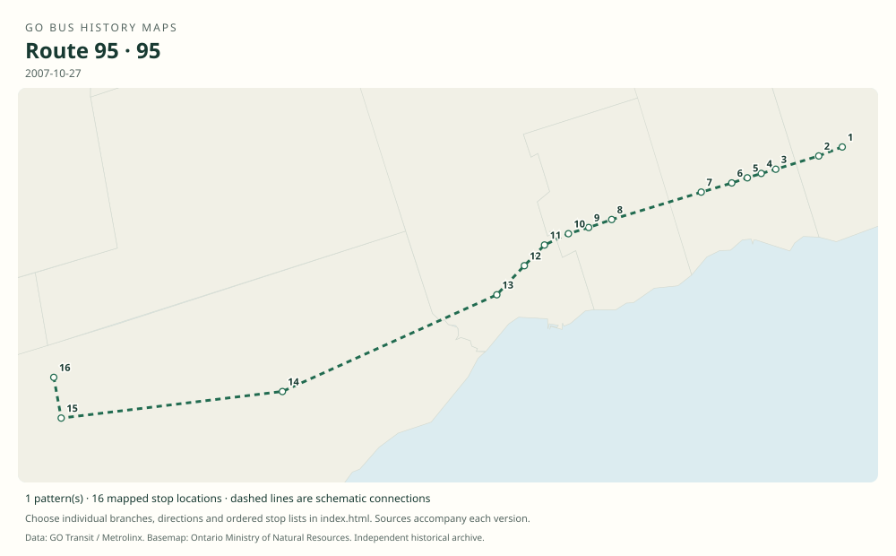

# GO route 95 — Oshawa Highway 2 Express–Finch

Limited-stop bus through Durham on Highway 2, continuing by Highway 401 to Scarborough Centre and Finch. It complemented the older local 94 and the station-based Highway 401 express 96.

**Status:** discontinued. **Documented patterns:** 1. **Research date:** 23 October 2026.

[Download history PDF](route-95-history.pdf) · [Interactive map](index.html) · [All ordered stops (CSV)](stops.csv) · [All mapped versions (GeoJSON)](maps.geojson) · [History data](history.json) · [Timetable archive links](archive-sources.json)

The PDF includes the sourced history, dated maps, numbered stop lists and navigation bookmarks. Older versions retain the timetable timing-point or major-stop limits described below.

Open `index.html` through the repository's local web server to use the map. SVG maps below display directly on GitHub.

## History

### 2007-04-28

Routes 95 and 96 were introduced as the Oshawa–Finch express network.

[Source 1](https://transittoronto.ca/regional/2115.shtml)

### 2007-10-27

The original route 95 schedule documents the Highway 2 stopping pattern and Finch destination.

[Source 1](https://go-schedule-archive.s3.us-east-1.amazonaws.com/oshawa-hwy-2-express/2008-12-03-table-95-oshawa-hwy-2-express.pdf)

### 2013-06-28

Last day of route 95 before the 92/96/98 reorganization.

[Source 1](https://transittoronto.ca/archives/weblog/2013/06/15-major_chan.shtml)

## Maps by documented version

Feed maps combine the patterns present in that dated file. The interactive viewer separates every branch and direction. A feed snapshot can include future or temporary service; its filename is not a route-change date.

| Date / evidence | Map | Patterns |
|---|---|---:|
| 2007-10-27 | [SVG map](maps/history-95-2007-main.svg) | 1 |

## Historical major-stop sequences

These are timetable timing points / major stops, not necessarily every roadside stop. Full GTFS sequences are in `stops.csv` and the snapshot files.

### 2007-10-27 — 95: Oshawa–Finch Highway 2 limited-stop service

Oshawa Bus Terminal → Highway 2 / Stevenson Rd — Oshawa → Dundas St / Thickson Rd — Whitby → Dundas St / Anderson St — Whitby → Dundas St / Garden St — Whitby → Dundas St / Brock St — Whitby → Dundas St / McQuay Blvd — Whitby → Highway 2 / Harwood Ave — Ajax → Highway 2 / Westney Rd — Ajax → Highway 2 / Church St — Ajax → Highway 2 / Brock Rd — Pickering → Highway 2 / Glenanna Rd — Pickering → Highway 2 / Fairport Rd — Pickering → Scarborough Centre Bus Terminal → Yonge St / Sheppard Ave → Finch Bus Terminal

Schematic straight connections between established stop areas, not a street-by-street reconstruction. Westbound timing points. In the opposite direction the Whitby stop is labelled White Oaks rather than McQuay. The bus uses Highway 2 through Durham, then the Highway 401 corridor toward Toronto.

[Original source 1](https://go-schedule-archive.s3.us-east-1.amazonaws.com/oshawa-hwy-2-express/2008-12-03-table-95-oshawa-hwy-2-express.pdf)

## Coverage and unresolved questions

- No public lettered 95 branches have been established from the examined original timetable.
- These are documented dated snapshots. Changes between snapshots, temporary diversions and every historical local stop have not all been recovered.
- Manually reconstructed versions generally contain published timetable timing points / major stops. They must not be read as complete roadside stop inventories.

## Sources

- [50 Years of GO Transit Bus Operations — Adam Zhelka / Transit Toronto](https://transittoronto.ca/regional/2115.shtml) — secondary
- [GO Oshawa Highway 2 Express route 95, printed effective October 27, 2007; archive filename December 3, 2008](https://go-schedule-archive.s3.us-east-1.amazonaws.com/oshawa-hwy-2-express/2008-12-03-table-95-oshawa-hwy-2-express.pdf) — original-timetable
- [Major changes to GO bus service along Highway 2, June 29, 2013 — Transit Toronto](https://transittoronto.ca/archives/weblog/2013/06/15-major_chan.shtml) — secondary

## Data attribution

Data used in this product or service is provided with the permission of Metrolinx. Metrolinx makes no representations or warranties of any kind, express or implied, with respect to the Data and assumes no responsibility for the accuracy or currency of the data used in this product or service.

Basemap: Ontario Ministry of Natural Resources, Open Government Licence – Ontario. See [methodology](../../docs/METHODOLOGY.md) for geometry and date limitations.
