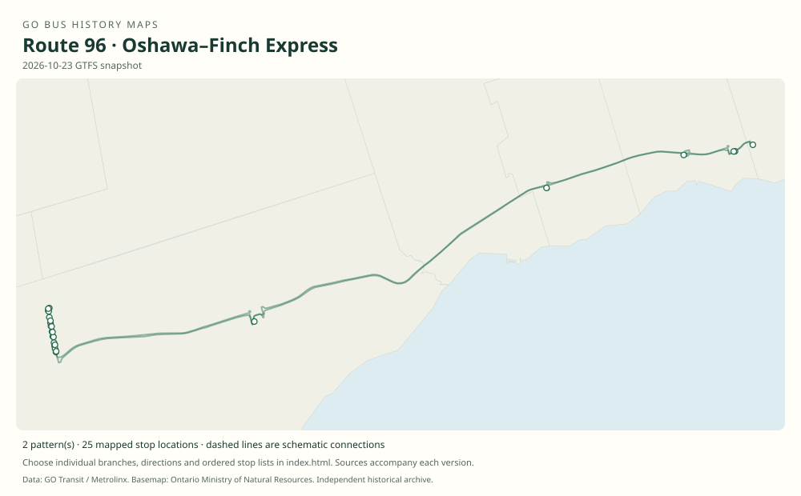

# GO route 96 — Oshawa–Finch Express

Highway 401 bus family linking Durham GO stations with North York. Multiple express and short branches were later consolidated as 96B; seasonal 96Z added the Toronto Zoo.

**Status:** current. **Documented patterns:** 32. **Research date:** 23 October 2026.

[Download history PDF](route-96-history.pdf) · [Interactive map](index.html) · [All ordered stops (CSV)](stops.csv) · [All mapped versions (GeoJSON)](maps.geojson) · [History data](history.json) · [Timetable archive links](archive-sources.json)

The PDF includes the sourced history, dated maps, numbered stop lists and navigation bookmarks. Older versions retain the timetable timing-point or major-stop limits described below.

Open `index.html` through the repository's local web server to use the map. SVG maps below display directly on GitHub.

## History

### 2007-04-28

Routes 95 and 96 began as complementary Oshawa–Finch express services.

[Source 1](https://transittoronto.ca/regional/2115.shtml)

### 2013-06-29

The original timetable documents 96 and branches A–D, with 96B serving Scarborough Centre between the Durham stations and Finch.

[Source 1](https://go-schedule-archive.s3.us-east-1.amazonaws.com/oshawa-finch-express/2013-06-29-table-96-oshawa-finch-express.pdf)

### 2019-01-05

The original timetable contains the 96, 96A, 96B, 96C, 96D and 96E family.

[Source 1](https://go-schedule-archive.s3.us-east-1.amazonaws.com/oshawa-finch-express/2019-01-05-table-96-oshawa-finch-express.pdf)

### 2020-09-05

Service was consolidated on 96B; branches 96, 96A, 96C, 96D and 96E were withdrawn.

[Source 1](https://transittoronto.ca/archives/weblog/2020/09/04-go_revises.shtml)

### 2023-05-20

Seasonal 96Z Toronto Zoo trips began alongside 96B.

[Source 1](https://www.metrolinx.com/en/discover/go-buses-to-popular-attractions-back-in-time-for-summer) · [Source 2](https://go-schedule-archive.s3.us-east-1.amazonaws.com/oshawa-finch-express/2023-05-20-table-96-oshawa-finch-express.pdf)

## Maps by documented version

Feed maps combine the patterns present in that dated file. The interactive viewer separates every branch and direction. A feed snapshot can include future or temporary service; its filename is not a route-change date.

| Date / evidence | Map | Patterns |
|---|---|---:|
| 2016-01-11 GTFS snapshot | [SVG map](maps/2016-01-11.svg) | 16 |
| 2022-03-08 GTFS snapshot | [SVG map](maps/2022-03-08.svg) | 4 |
| 2023-05-05 GTFS snapshot | [SVG map](maps/2023-05-05.svg) | 4 |
| 2026-10-23 GTFS snapshot | [SVG map](maps/2026-10-23.svg) | 2 |
| 2013-06-29 | [SVG map](maps/history-96-2013-main.svg) | 1 |
| 2013-06-29 | [SVG map](maps/history-96-2013-a.svg) | 1 |
| 2013-06-29 | [SVG map](maps/history-96-2013-b.svg) | 1 |
| 2013-06-29 | [SVG map](maps/history-96-2013-c.svg) | 1 |
| 2013-06-29 | [SVG map](maps/history-96-2013-d.svg) | 1 |
| 2023-05-20 | [SVG map](maps/history-96-2023-z.svg) | 1 |

## Historical major-stop sequences

These are timetable timing points / major stops, not necessarily every roadside stop. Full GTFS sequences are in `stops.csv` and the snapshot files.

### 2013-06-29 — 96: Oshawa–Finch bypassing Scarborough Centre

Oshawa GO → Whitby GO → Ajax GO → Yonge St / Sheppard Ave → Finch Bus Terminal

Schematic straight connections between established stop areas, not a street-by-street reconstruction. Ordered major timetable timing points, not an exhaustive list of intermediate stops. Lines are schematic, not a surveyed road alignment.

[Original source 1](https://go-schedule-archive.s3.us-east-1.amazonaws.com/oshawa-finch-express/2013-06-29-table-96-oshawa-finch-express.pdf)

### 2013-06-29 — 96A: Oshawa–Scarborough Centre

Oshawa GO → Whitby GO → Ajax GO → Scarborough Centre Bus Terminal

Schematic straight connections between established stop areas, not a street-by-street reconstruction. Ordered major timetable timing points, not an exhaustive list of intermediate stops. Lines are schematic, not a surveyed road alignment.

[Original source 1](https://go-schedule-archive.s3.us-east-1.amazonaws.com/oshawa-finch-express/2013-06-29-table-96-oshawa-finch-express.pdf)

### 2013-06-29 — 96B: Oshawa–Finch via Scarborough Centre

Oshawa GO → Whitby GO → Ajax GO → Scarborough Centre Bus Terminal → Yonge St / Sheppard Ave → Finch Bus Terminal

Schematic straight connections between established stop areas, not a street-by-street reconstruction. Ordered major timetable timing points, not an exhaustive list of intermediate stops. Lines are schematic, not a surveyed road alignment.

[Original source 1](https://go-schedule-archive.s3.us-east-1.amazonaws.com/oshawa-finch-express/2013-06-29-table-96-oshawa-finch-express.pdf)

### 2013-06-29 — 96C: Ajax–Finch express

Ajax GO → Yonge St / Sheppard Ave → Finch Bus Terminal

Schematic straight connections between established stop areas, not a street-by-street reconstruction. Ordered major timetable timing points, not an exhaustive list of intermediate stops. Lines are schematic, not a surveyed road alignment.

[Original source 1](https://go-schedule-archive.s3.us-east-1.amazonaws.com/oshawa-finch-express/2013-06-29-table-96-oshawa-finch-express.pdf)

### 2013-06-29 — 96D: Oshawa–Whitby–Finch express

Oshawa GO → Whitby GO → Yonge St / Sheppard Ave → Finch Bus Terminal

Schematic straight connections between established stop areas, not a street-by-street reconstruction. The 2013 96D row bypasses both Ajax GO and Scarborough Centre.

[Original source 1](https://go-schedule-archive.s3.us-east-1.amazonaws.com/oshawa-finch-express/2013-06-29-table-96-oshawa-finch-express.pdf)

### 2023-05-20 — 96Z: Toronto Zoo seasonal branch

Oshawa GO → Whitby GO → Ajax GO → Toronto Zoo → Scarborough Centre Bus Terminal → Yonge St / Sheppard Ave → Finch Bus Terminal

Schematic straight connections between established stop areas, not a street-by-street reconstruction. Seasonal summer branch. The sequence is the westbound order; service dates must be checked before treating it as available year-round.

[Original source 1](https://go-schedule-archive.s3.us-east-1.amazonaws.com/oshawa-finch-express/2023-05-20-table-96-oshawa-finch-express.pdf)

## Coverage and unresolved questions

- An archive PDF named 2009-02-19-table-96 actually contains route 93. It has deliberately not been used as evidence for route 96.
- Later seasonal operating periods and all short-turn details are not inferred from the 2023 Zoo timetable.
- These are documented dated snapshots. Changes between snapshots, temporary diversions and every historical local stop have not all been recovered.
- GTFS dates identify captured feeds, not necessarily the first or last day of a route. Open a pattern to see its exact scheduled service dates. Temporary rail replacement and special-service patterns are included when present in the source.
- Manually reconstructed versions generally contain published timetable timing points / major stops. They must not be read as complete roadside stop inventories.

## Sources

- [50 Years of GO Transit Bus Operations — Adam Zhelka / Transit Toronto](https://transittoronto.ca/regional/2115.shtml) — secondary
- [GO Oshawa/Pickering–Finch Express routes 96 and 98, effective June 29, 2013](https://go-schedule-archive.s3.us-east-1.amazonaws.com/oshawa-finch-express/2013-06-29-table-96-oshawa-finch-express.pdf) — original-timetable
- [GO Oshawa–Finch Express route 96, effective January 5, 2019](https://go-schedule-archive.s3.us-east-1.amazonaws.com/oshawa-finch-express/2019-01-05-table-96-oshawa-finch-express.pdf) — original-timetable
- [GO revises routes and services, September 5, 2020 — Transit Toronto](https://transittoronto.ca/archives/weblog/2020/09/04-go_revises.shtml) — secondary
- [Metrolinx: GO buses to popular attractions back in time for summer, 2023](https://www.metrolinx.com/en/discover/go-buses-to-popular-attractions-back-in-time-for-summer) — official
- [GO Oshawa–Finch Express including Toronto Zoo 96Z, effective May 20, 2023](https://go-schedule-archive.s3.us-east-1.amazonaws.com/oshawa-finch-express/2023-05-20-table-96-oshawa-finch-express.pdf) — original-timetable
- [GO Transit original GTFS snapshot 2016-01-11](https://openmobilitydata-data.s3.us-west-1.amazonaws.com/public/feeds/go-transit/32/20160111/gtfs.zip) — original-gtfs
- [GO Transit original GTFS snapshot 2022-03-08](https://web.archive.org/web/20220308054107id_/https://www.gotransit.com/static_files/gotransit/assets/Files/GO_GTFS.zip) — original-gtfs
- [GO Transit original GTFS snapshot 2023-05-05](https://openmobilitydata-data.s3.us-west-1.amazonaws.com/public/feeds/go-transit/32/20230505/gtfs.zip) — original-gtfs
- [GO Transit original GTFS snapshot 2026-10-23](https://assets.metrolinx.com/raw/upload/Documents/Metrolinx/Open%20Data/GO-GTFS.zip) — original-gtfs

## Data attribution

Data used in this product or service is provided with the permission of Metrolinx. Metrolinx makes no representations or warranties of any kind, express or implied, with respect to the Data and assumes no responsibility for the accuracy or currency of the data used in this product or service.

Basemap: Ontario Ministry of Natural Resources, Open Government Licence – Ontario. See [methodology](../../docs/METHODOLOGY.md) for geometry and date limitations.
