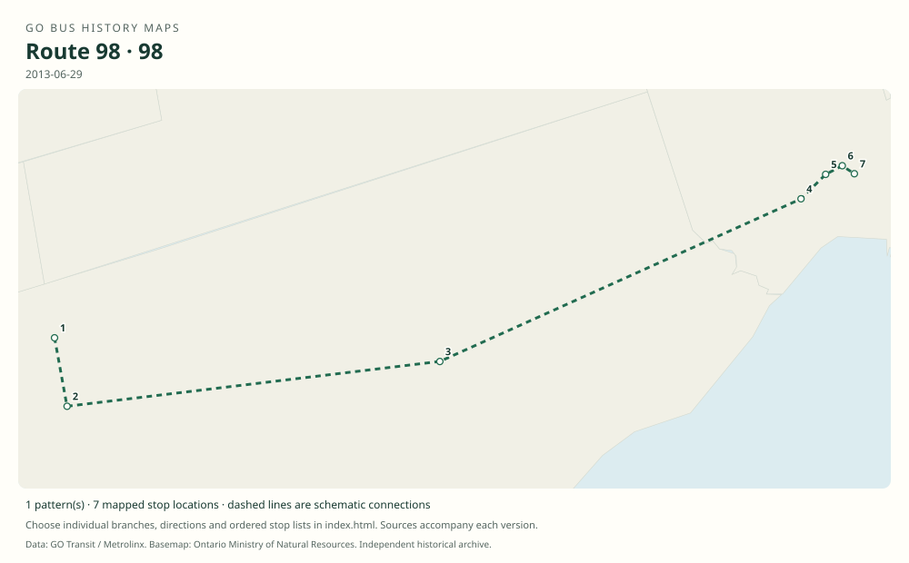

# GO route 98 — Pickering–Finch Express

Weekday peak-direction express service between Pickering GO, western Pickering, Scarborough Centre and Finch, created in the 2013 Highway 2 restructuring and replaced by 92A in 2014.

**Status:** discontinued. **Documented patterns:** 2. **Research date:** 23 October 2026.

[Download history PDF](route-98-history.pdf) · [Interactive map](index.html) · [All ordered stops (CSV)](stops.csv) · [All mapped versions (GeoJSON)](maps.geojson) · [History data](history.json) · [Timetable archive links](archive-sources.json)

The PDF includes the sourced history, dated maps, numbered stop lists and navigation bookmarks. Older versions retain the timetable timing-point or major-stop limits described below.

Open `index.html` through the repository's local web server to use the map. SVG maps below display directly on GitHub.

## History

### 2013-06-29

The new route 98 appears in the June 29 timetable; its weekday-only service first operated Tuesday July 2 after the holiday weekend.

[Source 1](https://go-schedule-archive.s3.us-east-1.amazonaws.com/oshawa-finch-express/2013-06-29-table-96-oshawa-finch-express.pdf) · [Source 2](https://transittoronto.ca/archives/weblog/2013/06/15-major_chan.shtml)

### 2014-08-29

Last operating day of route 98; replacement route 92A began Tuesday September 2.

[Source 1](https://transittoronto.ca/archives/weblog/2014/08/28-go_revises.shtml)

## Maps by documented version

Feed maps combine the patterns present in that dated file. The interactive viewer separates every branch and direction. A feed snapshot can include future or temporary service; its filename is not a route-change date.

| Date / evidence | Map | Patterns |
|---|---|---:|
| 2013-06-29 | [SVG map](maps/history-98-2013-westbound.svg) | 1 |
| 2013-06-29 | [SVG map](maps/history-98-2013-eastbound.svg) | 1 |

## Historical major-stop sequences

These are timetable timing points / major stops, not necessarily every roadside stop. Full GTFS sequences are in `stops.csv` and the snapshot files.

### 2013-06-29 — 98: Pickering–Finch morning express

Pickering GO — Bayly St / Liverpool Rd → Liverpool Rd / Pickering Pkwy → Highway 2 / Walnut Lane → Highway 2 / Fairport Rd → Scarborough Centre Bus Terminal → Yonge St / Sheppard Ave → Finch Bus Terminal

Schematic straight connections between established stop areas, not a street-by-street reconstruction. Original printed timetable pages 6–7 provide these timing points. Westbound trips are in the morning; eastbound trips operate in the afternoon.

[Original source 1](https://go-schedule-archive.s3.us-east-1.amazonaws.com/oshawa-finch-express/2013-06-29-table-96-oshawa-finch-express.pdf)

### 2013-06-29 — 98: Finch–Pickering afternoon express

Finch Bus Terminal → Yonge St / Sheppard Ave → Scarborough Centre Bus Terminal → Highway 2 / Fairport Rd → Highway 2 / Walnut Lane → Liverpool Rd / Pickering Pkwy → Pickering GO — Bayly St / Liverpool Rd

Schematic straight connections between established stop areas, not a street-by-street reconstruction. Same principal timing points in reverse order. The schematic does not claim all intermediate Kingston Road stops were timetable timing points.

[Original source 1](https://go-schedule-archive.s3.us-east-1.amazonaws.com/oshawa-finch-express/2013-06-29-table-96-oshawa-finch-express.pdf)

## Coverage and unresolved questions

- Route 98 is absent from later GTFS snapshots because it ended in 2014; its original timetable is essential evidence.
- These are documented dated snapshots. Changes between snapshots, temporary diversions and every historical local stop have not all been recovered.
- Manually reconstructed versions generally contain published timetable timing points / major stops. They must not be read as complete roadside stop inventories.

## Sources

- [GO Oshawa/Pickering–Finch Express routes 96 and 98, effective June 29, 2013](https://go-schedule-archive.s3.us-east-1.amazonaws.com/oshawa-finch-express/2013-06-29-table-96-oshawa-finch-express.pdf) — original-timetable
- [Major changes to GO bus service along Highway 2, June 29, 2013 — Transit Toronto](https://transittoronto.ca/archives/weblog/2013/06/15-major_chan.shtml) — secondary
- [GO revises services September 2, 2014, including 98 replacement by 92A — Transit Toronto](https://transittoronto.ca/archives/weblog/2014/08/28-go_revises.shtml) — secondary

## Data attribution

Data used in this product or service is provided with the permission of Metrolinx. Metrolinx makes no representations or warranties of any kind, express or implied, with respect to the Data and assumes no responsibility for the accuracy or currency of the data used in this product or service.

Basemap: Ontario Ministry of Natural Resources, Open Government Licence – Ontario. See [methodology](../../docs/METHODOLOGY.md) for geometry and date limitations.
